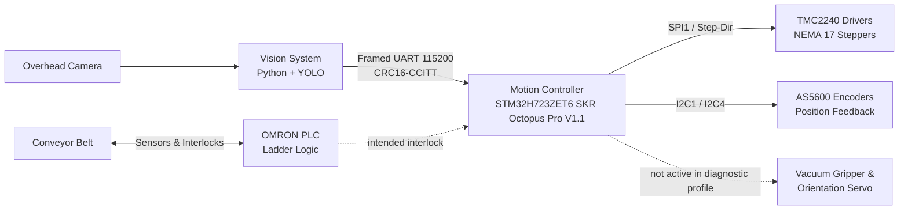

# XZ-Manipulator-Controls

**Integrasi Computer Vision dan Sistem Sortasi Konveyor untuk Pengendalian Kualitas (*Quality Control*) Komponen Kapasitor Berdasarkan Polaritas.**

Undergraduate Thesis Engineering Repository (*Tugas Akhir - Teknik Elektro / Sistem Komputer*).

---

## 1. System Overview

This repository contains software, firmware, hardware design, and test documentation for an automated capacitor inspection and sorting prototype:
1. **Perception & Quality Control:** Real-time overhead computer vision pipeline (YOLO + PCA continuous angle calculation) detecting capacitor polarity orientation and spatial coordinates on a moving conveyor belt.
2. **Motion & Actuation:** 2-Axis ($XZ$) Cartesian manipulator firmware (with provisioned $\theta$ driver slot) for **STM32H723ZET6** on a **BIGTREETECH SKR Octopus Pro V1.1** board, TMC2240 SPI stepper drivers, and AS5600 12-bit magnetic encoders. The default firmware profile (`motion_diagnostics`) builds as a cooperative diagnostic executor with `MOTION_DIAG_BOUNDS_CONFIRMED=ON` and `SAFE_Z=0` / `PICK_DEPTH=0` dry-run defaults; vacuum and servo actuation and physical hardware qualification are not complete.
3. **Conveyor & Material Handling:** Industrial conveyor workstation interlocked via an OMRON PLC running custom ladder logic.



---

## 2. Documentation Architecture

All core engineering specifications, protocols, wiring diagrams, and test guides are structured in [`docs/`](docs/):

```text
docs/
├── architecture/
│   ├── system_overview.md            # Block diagrams, subsystem roles & target sorting lifecycle
│   ├── communication_protocol.md     # 18-byte Host->STM32 UART frame & CRC16-CCITT specification
│   └── motion_diagnostics_design.md  # Dual-axis STM32->Host binary records, state machine & metrology
├── hardware/
│   ├── wiring.md                     # SKR Octopus Pro V1.1, TMC2240, AS5600 & sensor wiring
│   ├── bom_and_mechanics.md          # Bill of Materials, XZ gantry mechanics, and pneumatic specs
│   └── diagnostics_datasheet_notes.md # Datasheet evidence and open questions; vendor PDFs are not bundled
└── testing/
    ├── README.md                     # Automated test suites & bench verification index
    └── Perencanaan_Test_Realcase_XZ_Manipulator_Lengkap.xlsx
```

---

## 3. Subsystems & Directory Layout

```text
XZ-Manipulator-Controls/
├── docs/                  # Architecture, wire contracts, hardware wiring/notes & testing guides
├── Hardware/              # BTT Octopus Pro V1.1 submodule & legacy KiCad 10 schematic (XZ-Controller)
├── MotorControls/         # Embedded STM32 firmware profiles, C drivers, emulation & CLI tools
├── packages/              # Shared Python libraries (motion_diagnostics framing, CSV & metrics)
├── Program_Ladder/        # OMRON PLC conveyor ladder logic (CX-Programmer)
└── VisionSystem/          # Host PC Python / YOLO computer vision & UART telemetry pipeline
```

| Subsystem / Directory | Primary Role | Documentation |
| :--- | :--- | :--- |
| **[`Hardware/BIGTREETECH-OCTOPUS-Pro/`](Hardware/BIGTREETECH-OCTOPUS-Pro/)** | Official BTT Octopus Pro V1.1 schematics, pinouts & hardware manual (git submodule) | [`docs/hardware/wiring.md`](docs/hardware/wiring.md) |
| **[`Hardware/XZ-Controller/`](Hardware/XZ-Controller/)** | Legacy KiCad 10 `NUCLEO-F446RE` schematic/PCB, symbols/footprints, STEP models & `Optocoupler-io.kicad_sch` | [`docs/hardware/wiring.md`](docs/hardware/wiring.md) |
| **[`MotorControls/`](MotorControls/)** | Embedded STM32 subsystem (multi-profile H723 firmware, drivers, emulation & host CLI) | [`MotorControls/README.md`](MotorControls/README.md) |
| ├── **[`MotionFirmware/`](MotorControls/MotionFirmware/)** | STM32H723ZET6 CMake/Ninja suite (`motion_diagnostics`, `stallguard_cli`, `z_bounce_emulation`), flash/DFU scripts & BTT bootloader (`tools/btt_bootloader/`) | [`MotionFirmware/README.md`](MotorControls/MotionFirmware/README.md) |
| ├── **[`MotionFirmware/tools/diag/`](MotorControls/MotionFirmware/tools/diag/)** | Host Python bench CLI (`motion-diag`) for capture, sequences, heartbeats & reports | [`tools/diag/README.md`](MotorControls/MotionFirmware/tools/diag/README.md) |
| ├── **[`Drivers/`](MotorControls/Drivers/)** | Modular, host-tested C drivers for TMC2240 (SPI) and AS5600 (I2C) encoders | [`AS5600/README.md`](MotorControls/Drivers/AS5600/README.md), [`TMC2240-Driver/README.md`](MotorControls/Drivers/TMC2240-Driver/README.md) |
| ├── **[`Emulation/`](MotorControls/Emulation/)** | Python `MockFirmwareServer` + legacy Renode STM32F4 `.resc` USART2 TCP socket bridge | [`Emulation/README.md`](MotorControls/Emulation/README.md) |
| └── **[`tests/emulation/`](MotorControls/tests/emulation/)** | Automated STM32 UART protocol verification test suite | [`run_tests.py`](MotorControls/tests/emulation/run_tests.py) |
| **[`packages/motion_diagnostics/`](packages/motion_diagnostics/)** | Shared Python wire decoder, CRC16, correlation registry, long-form CSV & metrology | [`packages/motion_diagnostics/README.md`](packages/motion_diagnostics/README.md), [`motion_diagnostics_design.md`](docs/architecture/motion_diagnostics_design.md) |
| **[`VisionSystem/`](VisionSystem/)** | YOLO capacitor detection, PCA continuous angle calculation & conveyor tracking | [`VisionSystem/README.md`](VisionSystem/README.md) |
| **[`Program_Ladder/`](Program_Ladder/)** | OMRON PLC conveyor control ladder logic (CX-Programmer `.cxp`) | [`Program_Ladder/README.md`](Program_Ladder/README.md) |

---

## 4. Quick Start Guide

### A. Vision System (Host PC)
Requires Python 3.10+ per `VisionSystem/pyproject.toml` (examples below use Python 3.12), managed via [`uv`](https://github.com/astral-sh/uv) from the repository root:
```powershell
# 1. Sync declared dependencies (includes local editable motion-diagnostics package)
uv sync --project VisionSystem --python 3.12

# 2. Install Ultralytics YOLO into the same environment for live camera inference
uv pip install --python VisionSystem\.venv\Scripts\python.exe ultralytics

# 3. Run real-time detection & binary UART telemetry stream
uv run --project VisionSystem python VisionSystem\04_Source_Code\4_detect_realtime.py --uart-port COM9

# 4. Run offline verification & transport test suites (no hardware required)
uv run --project VisionSystem python VisionSystem\tests\verify_vision_system.py
uv run --project VisionSystem pytest
```

### B. Motion Firmware & Emulation (STM32H723ZET6 / SKR Octopus Pro V1.1)
Requires Arm GNU Toolchain (`arm-none-eabi-gcc`), CMake, and Ninja:
```powershell
# 1. Build all three STM32H723 firmware profiles (default MotionFirmware.* = motion_diagnostics)
Push-Location MotorControls\MotionFirmware
cmake --preset Debug
cmake --build --preset Debug
Pop-Location

# 2. Run host CTest + Cortex-M7 compile check for motion_diagnostics
.\MotorControls\MotionFirmware\Apps\motion_diagnostics\Tests\run_tests.ps1

# 3. Run STM32 UART protocol emulation suite (Mock / legacy Renode F4 .resc bridge)
uv run python MotorControls\tests\emulation\run_tests.py --mode mock

# 4. Flash a profile to SKR Octopus Pro V1.1 via SEGGER J-Link SWD (diagnostics | stallguard | zbounce) or USB-C DFU
Push-Location MotorControls\MotionFirmware
.\flash.cmd diagnostics
# Or via USB-C DFU (default MotionFirmware.bin with BOOT0 jumper fitted):
# .\flash_dfu.cmd
Pop-Location
```

---

## 5. Developer & AI Assistant Guidelines

- **Vision Remediation Baseline & Guardrails:** Contributors working on the vision pipeline or STM32 integration must preserve the completed remediation baseline and verification contracts in [`VisionSystem/REMEDIATION_PLAN_AI.md`](VisionSystem/REMEDIATION_PLAN_AI.md).
- **Environment & Toolchains:** System setup guidelines, compiler paths, and developer preferences are detailed in [`AGENTS.md`](AGENTS.md) and [`CLAUDE.md`](CLAUDE.md).
