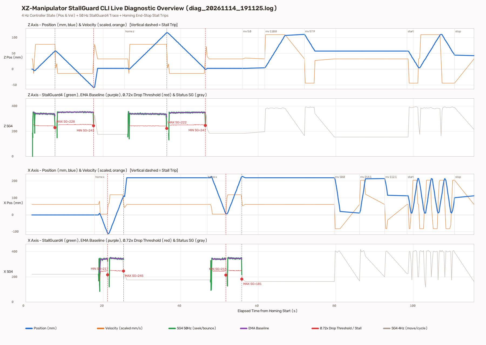
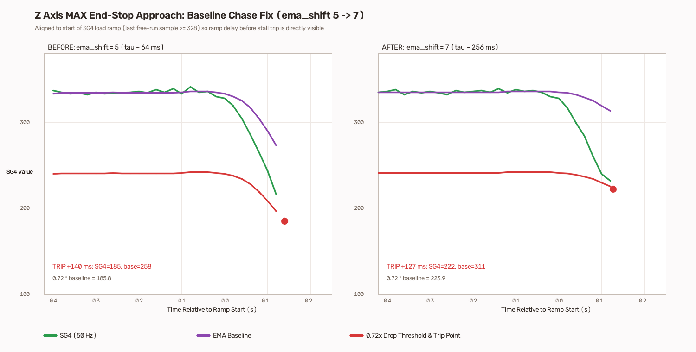

# Stage 1 Bring-Up Record — `stallguard_cli` (2026-11-14)

**Hardware:** BIGTREETECH SKR Octopus Pro V1.1 (`STM32H723ZET6` @ 400 MHz), 24 V supply (`J68` removed), `TMC2240 #0` (Z on `MOTOR1`), `TMC2240 #1` (X on `MOTOR0`), open-loop (`AS5600` encoders not wired yet).  
**Firmware Config:** [`app_config.c`](../../../../MotorControls/MotionFirmware/Apps/stallguard_cli/Src/app_config.c) (`invert_dir = true` on X & Z, `drop_ratio = 0.72f`, `confirm = 2U`, `abs_threshold = 160U`, `sg4_thrs_home = 80U`, Z `ema_shift = 7U` in `rerun_ema7` vs `5U` in `baseline_ema5`).  
**Capture & Replay Tools:**
- Automated CLI runner & PNG plotter: [`stallguard_cli_diag.py`](../../../../MotorControls/MotionFirmware/tools/stallguard_cli_diag.py)
- Rerun `.rrd` exporter: [`stallguard_to_rerun.py`](../../../../MotorControls/MotionFirmware/tools/stallguard_to_rerun.py)

---

## Contents

### 1. Rerun (`ema_shift = 7` on Z) — `rerun_ema7/`
- **Interactive Rerun Replay (`.rrd`):** [`rerun_ema7/movement_rerun_20261114_191125.rrd`](rerun_ema7/movement_rerun_20261114_191125.rrd)  
  Open directly with:
  ```powershell
  rerun docs\testing\records\stage1_stallguard_bringup_20261114\rerun_ema7\movement_rerun_20261114_191125.rrd
  ```
- **Raw 50 Hz + 4 Hz Serial Log:** [`rerun_ema7/diag_20261114_191125.log`](rerun_ema7/diag_20261114_191125.log)
- **Structured Summary JSON:** [`rerun_ema7/diag_20261114_191125.json`](rerun_ema7/diag_20261114_191125.json)
- **Plots:**
  - [`rerun_ema7/movement_overview_20261114_191449.png`](rerun_ema7/movement_overview_20261114_191449.png)
  - [`rerun_ema7/z_max_stall_comparison_20261114_191449.png`](rerun_ema7/z_max_stall_comparison_20261114_191449.png)

### 2. Baseline Prior to Z `ema_shift` Fix (`ema_shift = 5`) — `baseline_ema5/`
- **Raw Log:** [`baseline_ema5/diag_20261114_190404.log`](baseline_ema5/diag_20261114_190404.log)
- **Structured Summary JSON:** [`baseline_ema5/diag_20261114_190404.json`](baseline_ema5/diag_20261114_190404.json)

---

## Verified Summary (`rerun_ema7`)

- **Faults & Dropped Bytes:** `0` faults, `0` console bytes dropped (`console dropped 0 bytes`).
- **Two-End Homing Repeatability:**
  - **Z:** `run1 = 115.51 mm` (`MAX SG4 228 / base 318`, `MIN SG4 243 / base 347`), `run2 = 115.78 mm` (`MAX SG4 222 / base 311`, `MIN SG4 247 / base 344`).
  - **X:** `run1 = 223.89 mm` (`MIN SG4 217 / base 336`, `MAX SG4 245 / base 341`), `run2 = 224.12 mm` (`MIN SG4 215 / base 339`, `MAX SG4 181 / base 339`).
- **Soft-Limit & Midpoint Moves (`6/6` passed, `0.00 mm` commanded tracking error):**  
  `Z -> 5.00, 110.78, 57.89 mm`; `X -> 10.00, 214.12, 112.06 mm`.
- **Simultaneous `mode soft` Cycle (`12 s`):** `1` Z cycle and `4` X cycles completed cleanly (`0` faults).




